# IBM SPSS Statistics - Participant-Level Re-runs

> Version used: Version 31.0.1.0 (49)
>
> PROCESS Version used: v4.2_beta

---

> - **Question 1 - Are the confidence intervals in Table 2 and the error bars in Figure 5 too narrow?** Recalculate them across participants within each condition. This addresses Assessment 2 supervisor comments 3, 5 and 11 about treating 2,688 ratings as independent observations.
>
> - **Question 2 - Does the mediation result hold when the unit of analysis changes?** Optionally repeat PROCESS Model 4 on participant-by-condition means and compare it with the pooled-rating model in [recreate3.md](recreate3.md).

---

## 1 - Participant-level confidence intervals (Question 1)

### Why run this?

- The 84 participants each supplied 32 ratings: eight in each of four quadrants. The original confidence intervals used all 2,688 ratings (672 per quadrant) as though they came from independent people. Those intervals describe precision across pooled ratings and can make Table 2 and Figure 5 look more certain than the participant-level data justify.
- Average each participant's eight ratings within each quadrant, then estimate each quadrant's mean and 95% confidence interval across its **84 participant means**. This changes the unit used for the interval without changing the condition means in this balanced design.
- Keep the **pooled-rating *SD*** in Table 2 to describe the spread of individual ratings. The *SD* of the participant means is a different quantity and is used to calculate the participant-level interval.

### Aggregate the ratings

- Menu: `Data → Aggregate...`

- In the dialog, select:

    - Break Variable(s): `participant_index`, `quadrant`
    - Summaries of Variable(s): `c_expect_mean = MEAN(c_expect)` and `c_discom_mean = MEAN(c_discom)`
    - Save: **Create a new dataset containing only the aggregated variables**, or write those variables to a new data file and open it for the next step. Keep the original 2,688-row dataset for comparison.

    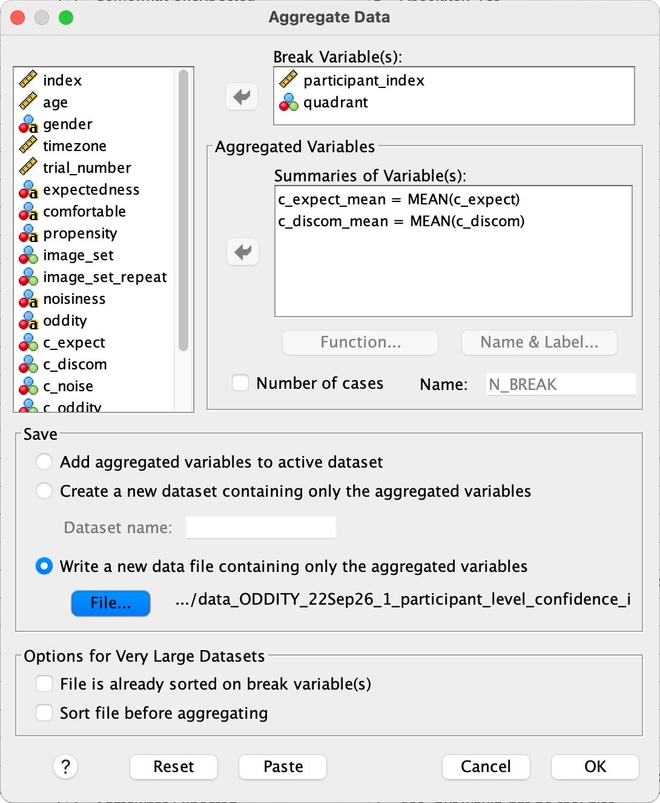

- OK. The result has **336 rows**: 84 participants × 4 quadrants, with one mean of eight ratings per participant and quadrant.

### Calculate the intervals

- On the aggregated dataset, menu: `Analyze → Descriptive Statistics → Explore`

- In the dialog, select:

    - Dependent List: `c_expect_mean`, `c_discom_mean`
    - Factor List: `quadrant`
    - **Statistics...**: tick **Descriptives**; Confidence Interval for Mean: **95%**

    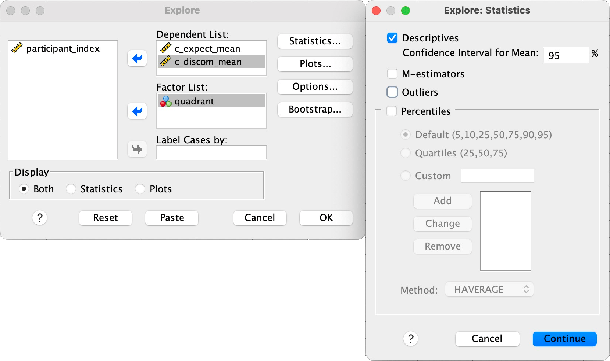

- Continue → OK

- The Case Processing Summary confirms **84 valid participant means and 0 missing** in each quadrant for each outcome. Read *M*, *SD*, Std. Error and the lower and upper 95% CI bounds from the Descriptives table.

    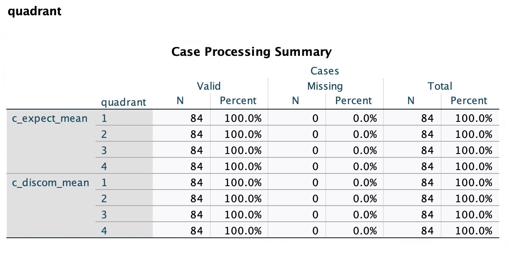
    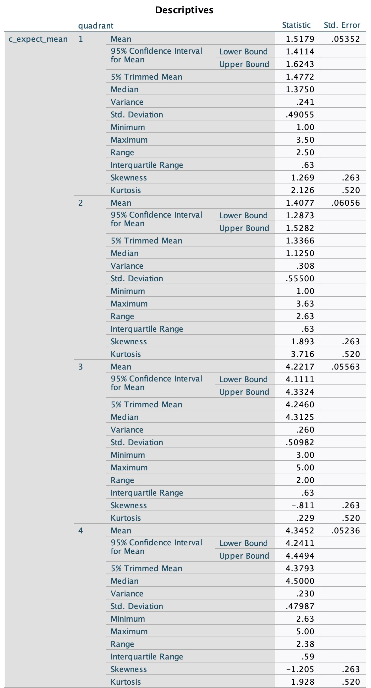
    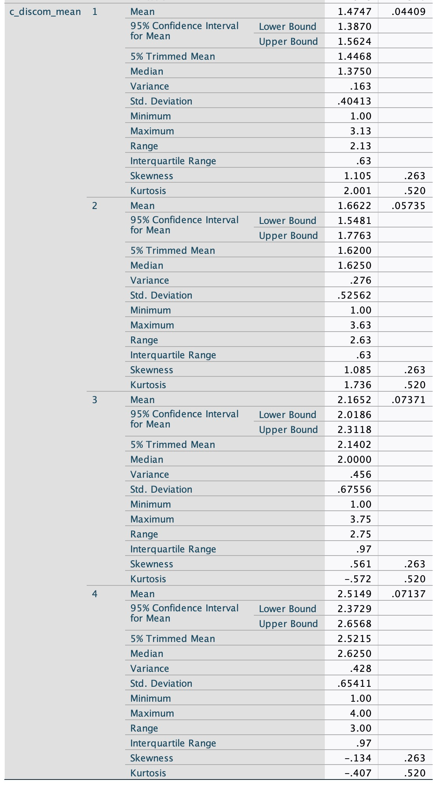

- Explore also produces stem-and-leaf plots and boxplots of the participant condition means. These show their distributions and flagged outliers; the confidence interval bounds come from the Descriptives tables above.

    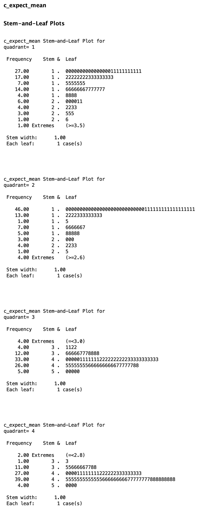
    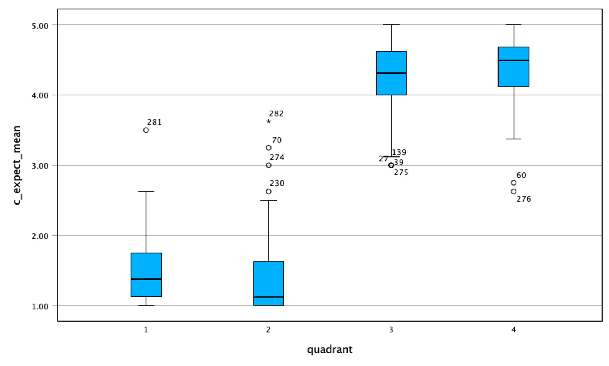
    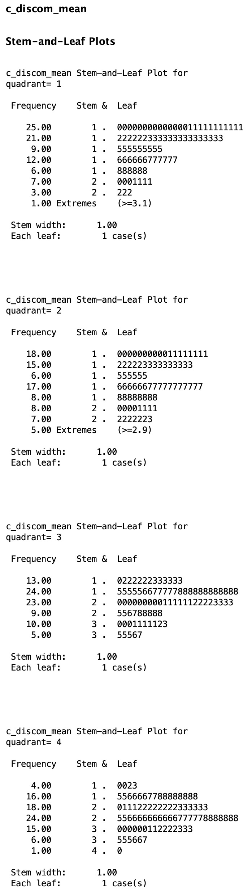
    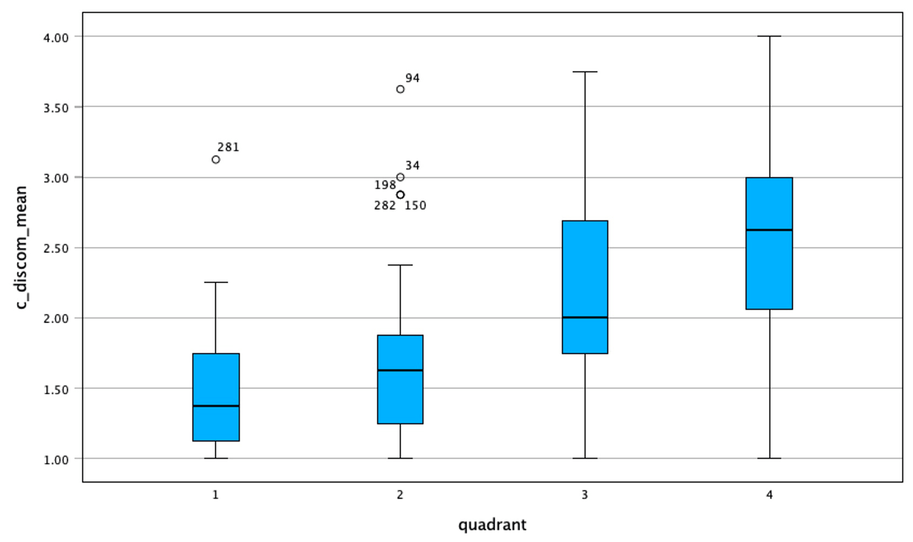

### Results and use in Table 2 and Figure 5

| Measure | Quadrant | Participant means (*n*) | *M* | *SD* of participant means | *SE* | 95% CI |
|---|:---:|:---:|---:|---:|---:|:---:|
| Unexpectedness | 1 | 84 | 1.5179 | 0.4906 | 0.0535 | [1.4114, 1.6243] |
| Unexpectedness | 2 | 84 | 1.4077 | 0.5550 | 0.0606 | [1.2873, 1.5282] |
| Unexpectedness | 3 | 84 | 4.2217 | 0.5098 | 0.0556 | [4.1111, 4.3324] |
| Unexpectedness | 4 | 84 | 4.3452 | 0.4799 | 0.0524 | [4.2411, 4.4494] |
| Discomfort | 1 | 84 | 1.4747 | 0.4041 | 0.0441 | [1.3870, 1.5624] |
| Discomfort | 2 | 84 | 1.6622 | 0.5256 | 0.0574 | [1.5481, 1.7763] |
| Discomfort | 3 | 84 | 2.1652 | 0.6756 | 0.0737 | [2.0186, 2.3118] |
| Discomfort | 4 | 84 | 2.5149 | 0.6541 | 0.0714 | [2.3729, 2.6568] |

- Quadrants 1–4 correspond to normal / low activity, normal / high activity, oddity / low activity and oddity / high activity, respectively.
- Use these **participant-level CI bounds** for Table 2's interval columns and Figure 5's error bars. Retain the pooled-rating means and *SD*s for the descriptive columns, and state in both notes that each interval was calculated across 84 participant condition means. The original pooled-rating intervals are documented in [recreate1.md](recreate1.md).

---

## 2 - Mediation sensitivity to the unit of analysis (Question 2; optional)

### Why run this?

- The mediation in [recreate3.md](recreate3.md) pools all 2,688 ratings, although the same 84 people supplied them. Re-running the same PROCESS Model 4 on the **336 participant-by-condition means** checks whether the indirect effect and the sign of the direct effect persist after the eight ratings in each participant's condition have been averaged.
- This is a sensitivity analysis, not 336 independent participants: each person still contributes four condition rows. Averaging removes within-condition variation in the mediator, increases its overlap with oddity, and can change the estimates and uncertainty for path *b* and especially the direct effect *c′*. The resulting standard errors still do not account for dependence between the four rows from one participant.

### Prepare the aggregated dataset

- Use the 336-row dataset from Question 1. The aggregation retains `participant_index`, `quadrant`, `c_expect_mean` and `c_discom_mean`; it does not retain the original trial-level factor columns. Recreate the two 0/1 factors from `quadrant` before running PROCESS:

    | Quadrant | Oddity (`c_oddity`) | Activity (`c_noise`) |
    |:---:|:---:|:---:|
    | 1 | 0 | 0 |
    | 2 | 0 | 1 |
    | 3 | 1 | 0 |
    | 4 | 1 | 1 |

- Menu: `Transform → Compute Variable...`. Compute `c_oddity` as `(quadrant = 3 OR quadrant = 4)` and `c_noise` as `(quadrant = 2 OR quadrant = 4)`. In Variable View, rename `c_expect_mean` to `c_expect` and `c_discom_mean` to `c_discom` on this **aggregated dataset only**, matching the names shown in the PROCESS screenshots. These renamed variables still contain participant condition means.

### Run the same PROCESS model

- Menu: `Analyze → Regression → PROCESS v4.2 by Andrew F. Hayes`

- In the dialog, select:

    - Y variable: `c_discom` (aggregated mean discomfort)
    - X variable: `c_oddity`
    - Mediator(s) M: `c_expect` (aggregated mean unexpectedness)
    - Covariate(s): `c_noise`
    - Model number: `4`
    - Confidence intervals: `95`
    - Number of bootstrap samples: `10000`

    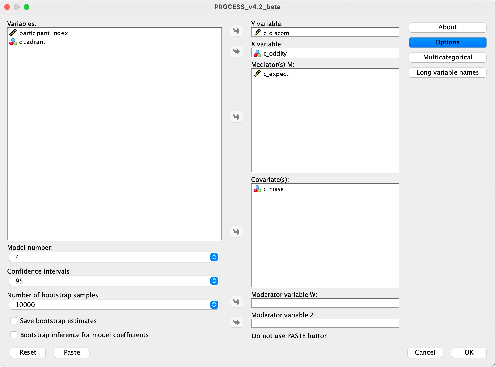

- Select **Options**: tick **Show total effect model** and **Standardized effects**; set heteroscedasticity-consistent inference to **HC4 (Cribari-Neto)**.

    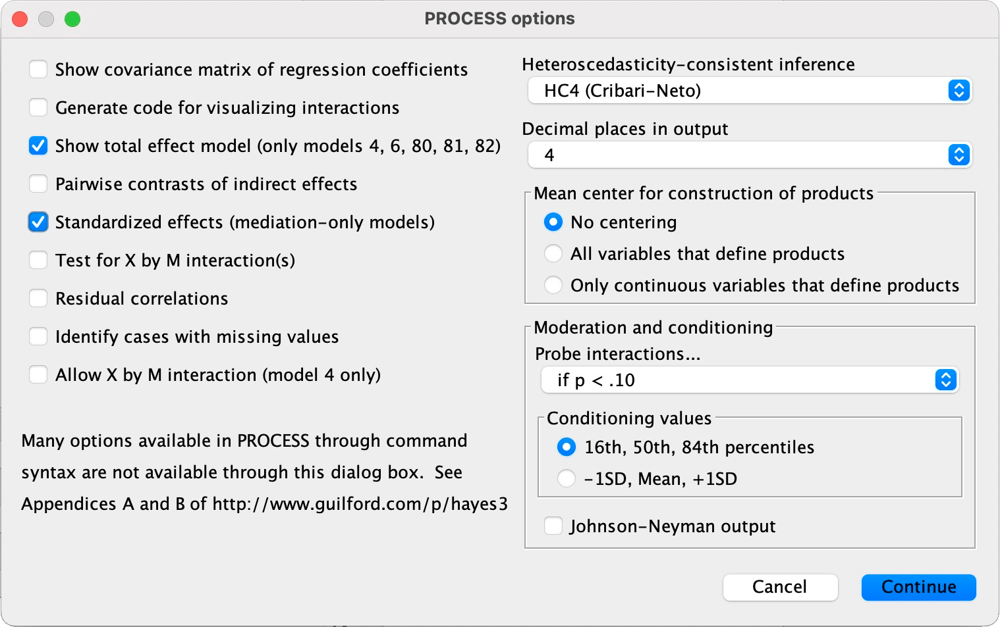

- For a reproducible bootstrap interval, run the model from the designated Syntax Window with the same fixed seed used in [recreate3.md](recreate3.md):

    ```txt
    PROCESS
        y=c_discom
        /x=c_oddity
        /m=c_expect
        /cov=c_noise
        /model=4
        /boot=10000
        /conf=95
        /hc=4
        /effsize=1
        /stand=1
        /total=1
        /seed=20260727.
    ```

### Results and comparison

- Check the PROCESS header for **Sample Size: 336**. Read paths *a* and *b* from the mediator and outcome models, *c* and *c′* from the total and direct effect tables, and the bootstrap bounds for *a×b* from Indirect effect(s) of X on Y.

    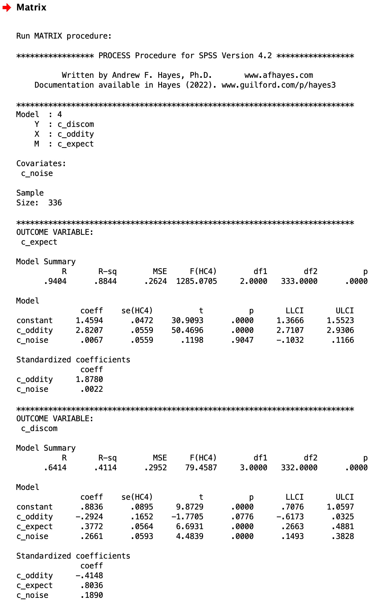
    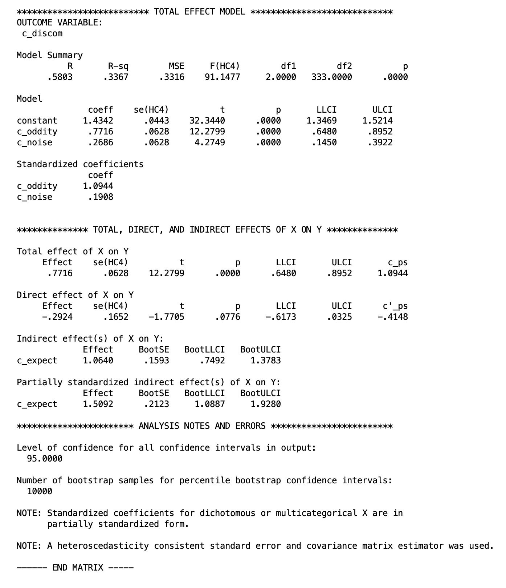

- The screenshots record the available PROCESS output. A fresh run with the fixed-seed syntax above may give slightly different bootstrap bounds; compare the output from that run when reporting a reproducible interval.

| Path | Effect | *SE* (HC4 or BootSE) | 95% CI | *p* |
|---|---:|---:|:---:|:---:|
| *a* (oddity → unexpectedness) | 2.8207 | 0.0559 | [2.7107, 2.9306] | < .001 |
| *b* (unexpectedness → discomfort, controlling oddity) | 0.3772 | 0.0564 | [0.2663, 0.4881] | < .001 |
| *c* (total) | 0.7716 | 0.0628 | [0.6480, 0.8952] | < .001 |
| *c′* (direct) | −0.2924 | 0.1652 | [−0.6173, 0.0325] | .078 |
| *a×b* (indirect) | 1.0640 | 0.1593 (BootSE) | [0.7492, 1.3783] | — |

- The indirect-effect interval still excludes zero, so the mediation finding holds in this sensitivity run. The direct path remains negative but its interval now includes zero. Paths *a* and *c* retain the same point estimates as the pooled-rating model because the design is balanced; their standard errors increase. Path *b* and *c′* also change because averaging removes within-condition variation in unexpectedness.
- Compare these values with the pooled-rating paths in [recreate3.md](recreate3.md). If reporting this optional analysis, label the 336 observations as **participant × condition means**, state that each participant appears four times, and note that this run does not fully adjust inference for repeated measures across conditions.
