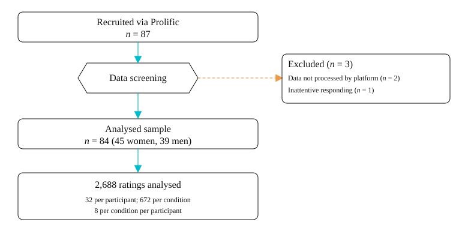
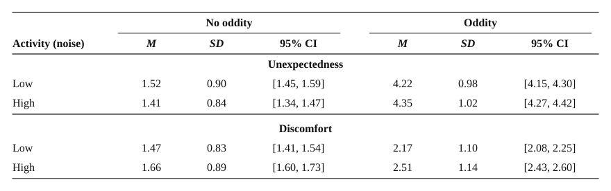
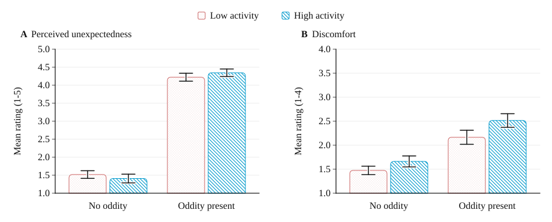
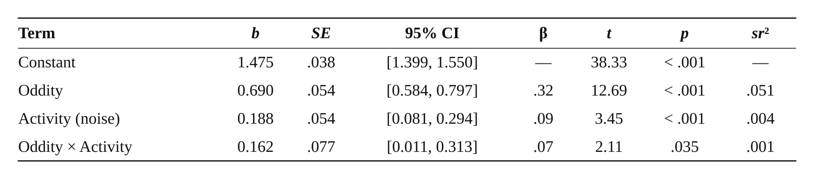
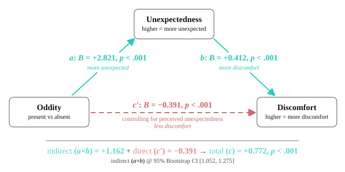
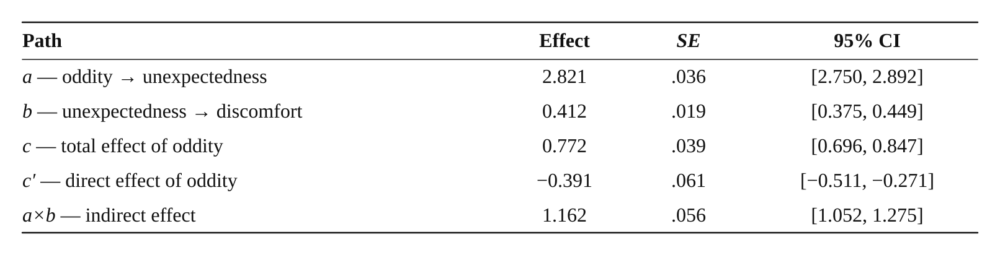
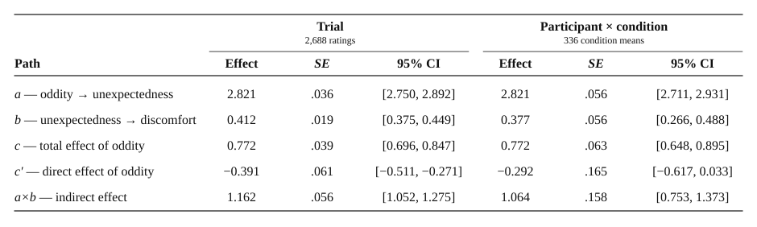

---
---

# Results

The analyses reported below examine whether visual oddity raises self-reported discomfort and whether perceived unexpectedness carries that effect. Participant flow, data screening and assumption testing are presented first, followed by descriptive statistics and the tests of each hypothesis in turn.

## Participant Flow and Data Screening

Eighty-seven participants were recruited. Two were excluded because their sessions were not fully processed by the hosting platform and returned no usable data, and one for inattentive responding, having failed four of the five attention checks embedded in the other studies in the combined battery. The analysed sample comprised 84 participants (45 women, 39 men) aged 18 to 69 years, *M* = 40.87, *SD* = 12.86 (Figure 4).

**Figure 4**  
*Participant Flow From Recruitment to Analysed Sample*  
  
*Note.* The present task contained no attention check of its own, as its design did not involve reaction-time measurement. No item-level data were missing and no ratings were excluded from the analysed set.

Because both rating items required a response before the task would advance, the retained sessions contained no missing item-level data, and each participant completed all 32 trials, yielding 2,688 ratings. Cross-tabulation confirmed a fully balanced design, with 672 ratings in each condition and eight per condition per participant. No ratings were excluded as outliers, both measures being bounded scales on which no value could fall out of range.

## Assumption Testing

Assumptions were evaluated for the multiple regression used to test H1 and H2 and, where shared, for the mediation model. Because both factors were dummy-coded and their product was retained, the model was saturated with respect to the four design cells and reproduced the cell means exactly, so linearity was not at issue. Multicollinearity fell within accepted limits (oddity and activity: tolerance = .50, VIF = 2.00; interaction: tolerance = .33, VIF = 3.00; maximum condition index = 5.83), the observed values being the expected consequence of entering the product of two dummy variables. The Durbin–Watson statistic was 1.68. No case exerted undue influence: the largest absolute standardised residual was 2.53, with none exceeding ±3, maximum Cook's distance was .002, and maximum centred leverage was .001.

Two assumptions were not met. The residual histogram and normal P–P plot showed departures from normality, residuals falling at a small number of discrete values - a consequence of the four-point outcome scale rather than of misspecification. Residual variance also differed across the four cells (*SD*s of 0.83 to 1.14), indicating heteroscedasticity. With 2,688 ratings, ordinary least squares estimates remain unbiased and the sampling distribution of the coefficients approximately normal; heteroscedasticity-consistent (HC4) standard errors were nonetheless used throughout the mediation analysis.

## Descriptive Statistics

Across all 2,688 ratings, perceived unexpectedness averaged 2.87 (*SD* = 1.69) on the five-point scale and discomfort 1.95 (*SD* = 1.08) on the four-point scale, both measures spanning their full response range. Condition means are reported in Table 2 and displayed in Figure 5.

**Table 2**  
*Perceived Unexpectedness and Discomfort by Oddity and Activity Level*  
  
*Note.* Each condition comprises 672 ratings contributed by 84 participants, eight ratings per participant. *M* and *SD* describe the individual ratings. Confidence intervals are computed across the 84 participant condition means (*df* = 83) rather than across the pooled ratings, and so reflect the precision with which each condition mean is estimated across people; intervals computed across the pooled ratings would be about two-thirds as wide.

Unexpectedness separated sharply by oddity and not by activity: scenes containing an out-of-place element averaged 4.28 against 1.46 for scenes without one, a difference of 2.82 scale points, whereas the two activity levels differed by less than 0.01 of a scale point. Discomfort rose with both factors, though unevenly, from 1.57 for normal scenes to 2.34 for oddity scenes, and from 1.82 for low-activity to 2.09 for high-activity scenes.

**Figure 5**  
*Mean Perceived Unexpectedness and Discomfort by Condition*  
  
*Note.* Error bars are 95% confidence intervals computed across the 84 participant condition means, not across the pooled ratings. Scales differ between panels: unexpectedness was rated on a five-point scale and discomfort on a four-point scale, in both cases with higher scores indicating more of the named attribute.

## Effects of Oddity and Activity on Discomfort (H1 and H2)

H1 predicted greater discomfort for scenes containing out-of-place elements. H2 predicted that activity level would neither affect discomfort nor interact with oddity. Both were tested in a single 2 × 2 factorial design, fitted as a multiple regression with oddity, activity and their product entered simultaneously, so that the unstandardised simple effects, their confidence intervals and the unique variance attributable to each term could be read directly from one model.

The model was significant, *F*(3, 2684) = 151.76, *p* < .001, accounting for 14.5% of the variance in discomfort, *R*² = .145, adjusted *R*² = .144, Cohen's *f*² = 0.17. Coefficients are reported in Table 3.

**Table 3**  
*Multiple Regression Predicting Discomfort From Oddity, Activity Level and Their Interaction*  
  
*Note.* *N* = 2,688 ratings. Oddity (0 = absent, 1 = present) and activity (0 = low, 1 = high) were dummy-coded. With the interaction retained, the coefficients are simple effects rather than main effects: the constant is predicted discomfort in the normal / low-activity condition, and the oddity and activity terms are the effect of each factor at the reference level of the other. *sr*² = squared semipartial correlation, the proportion of variance in discomfort uniquely attributable to each term.

H1 was supported. Oddity raised discomfort by 0.69 scale points in low-activity scenes, *b* = 0.690, 95% CI [0.584, 0.797], β = .32, *t*(2684) = 12.69, *p* < .001, *sr*² = .051. Scenes containing an out-of-place element were rated as less comfortable to enter than otherwise identical scenes without one, and the effect held at both activity levels, the corresponding simple effect in high-activity scenes being 0.85 scale points. Oddity was the largest term in the model, uniquely accounting for 5.1% of the variance in discomfort against 0.4% and 0.1% for the remaining terms.

H2 was not supported, on both of its components. Activity level exerted a small but significant effect on discomfort in normal scenes, *b* = 0.188, 95% CI [0.081, 0.294], β = .09, *t*(2684) = 3.45, *p* < .001, *sr*² = .004, busier scenes being rated less comfortable than quieter ones. The oddity × activity interaction was also significant, *b* = 0.162, 95% CI [0.011, 0.313], β = .07, *t*(2684) = 2.11, *p* = .035, *sr*² = .001, the increase in discomfort produced by oddity being larger in high-activity than in low-activity scenes. Both intervals excluded zero, so activity level did not function as an inert control factor, though the interaction accounted for only 0.1% of unique variance with a lower bound of 0.011.

## Perceived Unexpectedness as a Mediator (H3)

H3 predicted that oddity would raise perceived unexpectedness and that unexpectedness would carry the effect of oddity on discomfort. This was tested with a simple mediation model (PROCESS Model 4; Hayes, 2017), with oddity as the predictor, perceived unexpectedness as the mediator, discomfort as the outcome and activity level as a covariate, using 10,000 bootstrap samples, HC4 standard errors and a fixed random seed (20260727). The model is shown in Figure 6 and path estimates in Table 4.

**Figure 6**  
*Mediation Model of Oddity, Perceived Unexpectedness and Discomfort*  
  
*Note.* Unstandardised coefficients from PROCESS Model 4, controlling for activity level. Path *a* = oddity to perceived unexpectedness; path *b* = perceived unexpectedness to discomfort, controlling for oddity; path *c*' = the direct effect of oddity on discomfort, controlling for perceived unexpectedness.

Oddity raised perceived unexpectedness, *a* = 2.821, 95% CI [2.750, 2.892], *t*(2685) = 77.94, *p* < .001, and perceived unexpectedness in turn predicted greater discomfort with oddity held constant, *b* = 0.412, 95% CI [0.375, 0.449], *t*(2684) = 21.88, *p* < .001. The bootstrapped indirect effect was positive and its interval excluded zero, *a×b* = 1.162, BootSE = 0.056, 95% CI [1.052, 1.275], with a partially standardised value of 1.078, 95% CI [0.984, 1.175].

H3 was supported: the effect of oddity on discomfort was transmitted through how unexpected the scene was judged to be. The mediator model accounted for 69.4% of the variance in perceived unexpectedness, *R*² = .694, *F*(2, 2685) = 3045.82, *p* < .001, and the outcome model for 27.2% of the variance in discomfort, *R*² = .272, *F*(3, 2684) = 315.20, *p* < .001.

**Table 4**  
*Path Estimates for the Mediation of Oddity on Discomfort by Perceived Unexpectedness*  
  
*Note.* *N* = 2,688 ratings. *a* = oddity to perceived unexpectedness; *b* = perceived unexpectedness to discomfort, controlling for oddity; *c* = total effect of oddity on discomfort; *c*' = direct effect of oddity on discomfort, controlling for perceived unexpectedness; *a×b* = indirect effect. Standard errors for *a*, *b*, *c* and *c*' are heteroscedasticity-consistent (HC4); the interval for *a×b* is a percentile bootstrap interval from 10,000 samples and its standard error is the bootstrap standard error. All paths control for activity level.

The total effect of oddity on discomfort was positive, *c* = 0.772, 95% CI [0.696, 0.847], *t*(2685) = 20.04, *p* < .001, but the direct effect was negative, *c*' = −0.391, 95% CI [−0.511, −0.271], *t*(2684) = −6.38, *p* < .001. Because the indirect effect exceeded the total effect, the two pathways ran in opposite directions and partially cancelled, a pattern termed inconsistent mediation: with perceived unexpectedness held constant, oddity scenes were rated slightly more comfortable than normal scenes. A proportion-mediated index is not reported: it expresses the indirect effect as a share of the total, and under cancellation the total is a remainder rather than a whole that contains it. Activity level dissociated across the two models, predicting discomfort (coefficient 0.266, *p* < .001) but not perceived unexpectedness (0.007, *p* = .853).

## Sensitivity to the Unit of Analysis

The analyses above pooled all 2,688 ratings, as specified in the analysis plan. Because each participant contributed 32 of them, the mediation was re-estimated on the 336 participant condition means, each averaging one participant's eight ratings in one condition, with the model otherwise unchanged (Table 5).

**Table 5**  
*Mediation Path Estimates at Two Units of Analysis*  
  
*Note.* Trial level: 2,688 ratings. Participant × condition: 336 rows, each the mean of the eight ratings one participant contributed to one condition. Both are PROCESS Model 4 with activity level as a covariate, HC4 standard errors and 10,000 bootstrap samples; the *a×b* interval is a percentile bootstrap interval and its *SE* the bootstrap standard error. *a* and *c* are identical across units to four decimal places, as the balanced design requires; only their standard errors differ.

Paths *a* and *c* were unchanged to four decimal places, as the balanced design requires, though their standard errors rose by more than half. The indirect effect remained positive with an interval excluding zero, *a×b* = 1.064, BootSE = 0.159, 95% CI [0.749, 1.378], supporting H3 at this unit also.

The direct effect remained negative but was no longer distinguishable from zero, *c*' = −0.292, 95% CI [−0.617, 0.033], *t*(332) = −1.77, *p* = .078, its standard error 2.7 times the trial-level value against 1.6 for the total effect. Averaging within condition removes the variation in perceived unexpectedness that separates the direct from the indirect path. Each participant contributed four rows, so these standard errors still do not account for the dependence among those rows.

## Summary of Findings

Oddity raised discomfort, supporting H1: scenes containing an out-of-place element were rated as less comfortable to enter than otherwise identical scenes without one, at both levels of activity. Activity level was not inert, both its effect and its interaction with oddity reaching significance, H2 was not supported, though each accounted for less than a tenth of the unique variance attributable to oddity. Perceived unexpectedness carried the effect of oddity on discomfort, supporting H3 at both units of analysis. The direct pathway was negative at both units, though its interval excluded zero only at the rating level.

