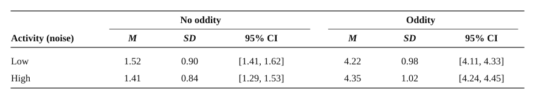
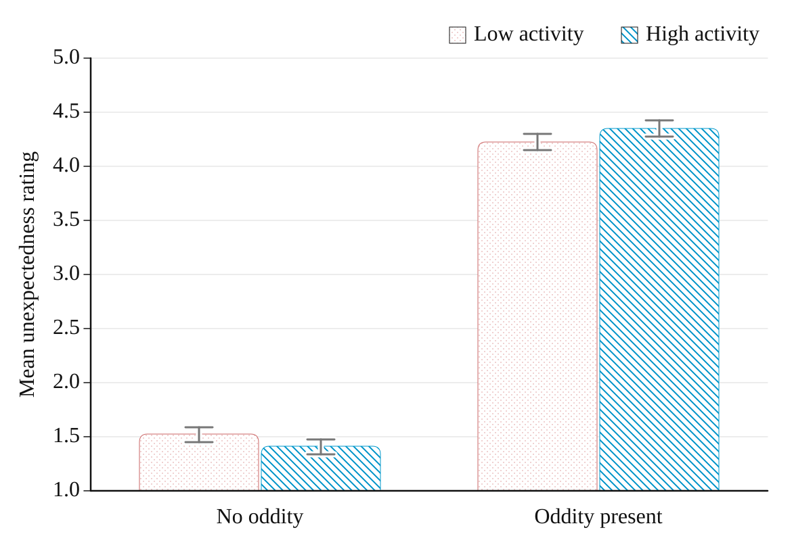
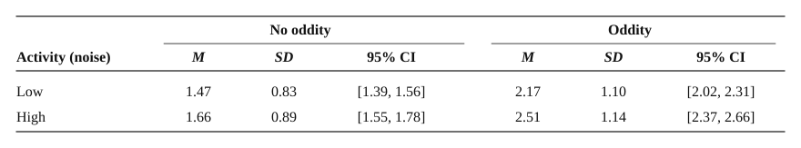
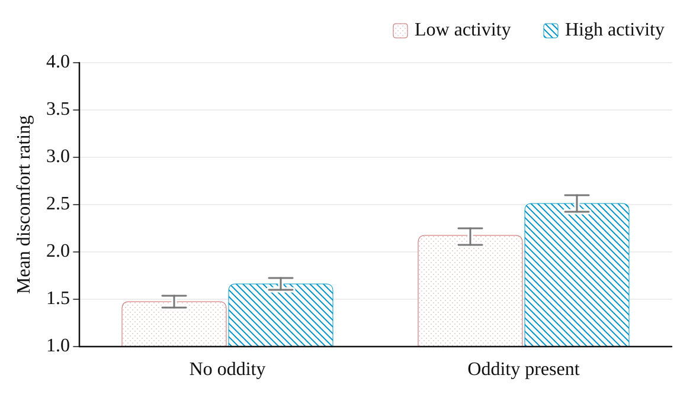

---
---

# Results

The analyses reported below examine whether visual oddity raises self-reported discomfort and whether perceived unexpectedness carries that effect. Participant flow, data screening and assumption testing are presented first, followed by descriptive statistics and the tests of each hypothesis in turn.

## Participant Flow and Data Screening

A total of 87 participants were recruited. Two were excluded because their sessions were not fully processed by the hosting platform and returned no usable data, and one for inattentive responding, having failed four of the five attention checks embedded in the other studies in the combined battery. The analysed sample comprised 84 participants (45 women, 39 men) aged 18 to 69 years (*M* = 40.87, *SD* = 12.86; Figure 4).

**Figure 4**  
*Participant Flow from Recruitment to Analysed Sample*  
  

Because both rating items required a response before the task would advance, the retained sessions contained no missing item-level data, and each participant completed all 32 trials, yielding 2,688 ratings. Cross-tabulation confirmed a fully balanced design, with 672 ratings in each condition and eight per condition per participant. No ratings were excluded as outliers; both measures being bounded scales on which no value could fall out of range.

## Assumption Testing

Assumptions were evaluated for the multiple regression used to test the first two hypotheses: that scenes containing out-of-place elements would produce greater discomfort (H1), and that activity level would neither affect discomfort nor interact with oddity (H2). Where the same assumptions applied, they were also evaluated for the mediation model testing whether perceived unexpectedness carried the effect of oddity on discomfort (H3). Because both factors were dummy-coded and their product was retained, the model was saturated with respect to the four design cells and reproduced the cell means exactly, so linearity was not at issue. Multicollinearity, assessed with tolerance and the variance inflation factor (VIF), fell within accepted limits (oddity and activity: tolerance = .50, VIF = 2.00; interaction: tolerance = .33, VIF = 3.00; maximum condition index = 5.83), the observed values being the expected consequence of entering the product of two dummy variables. The Durbin–Watson statistic was *d* = 1.68, within the conventional range of 1 to 3. No case exerted undue influence: the largest absolute standardised residual was 2.53, with none falling below −3 or above 3; maximum Cook’s distance was .002, and maximum centred leverage was .001.

Two assumptions were not met. The residual histogram and normal P–P plot showed departures from normality, with residuals falling at a small number of discrete values. This reflected the four-point outcome scale rather than misspecification of the model. Residual variance also differed across the four cells (*SD*s of 0.83 to 1.14), indicating heteroscedasticity. Neither violation was judged to warrant a change of analysis, for three reasons. First, both affect the precision of the estimates rather than the estimates themselves, since ordinary least squares coefficients remain unbiased when residuals are non-normal or unequal in variance. Second, with 2,688 ratings, the sampling distribution of the coefficients is approximately normal whatever the shape of the residuals. Third, the design was fully balanced, which makes regression tests robust to unequal variances of this size (Box, 1954); the largest cell variance was less than twice the smallest. As an added safeguard, heteroscedasticity-consistent (HC4) standard errors were used throughout the mediation analysis (Hayes & Cai, 2007).

## Descriptive Statistics

Across all 2,688 ratings, perceived unexpectedness averaged 2.87 (*SD* = 1.69) on its 1–5 scale and discomfort 1.95 (*SD* = 1.08) on its 1–4 scale, both measures spanning their full response range. Because the two measures used different scales, their condition means are reported separately below.

### Perceived Unexpectedness

Perceived unexpectedness separated sharply by oddity and not by activity (Table 2; Figure 5). Scenes containing an out-of-place element averaged 4.28 against 1.46 for scenes without one, a difference of 2.82 scale points, whereas the two activity levels differed by less than 0.01 of a scale point.

**Table 2**  
*Perceived Unexpectedness by Oddity and Activity Level*  
  
*Note.* Ratings on a 1–5 scale, higher scores indicating greater unexpectedness. Each condition comprises 672 ratings contributed by 84 participants, eight ratings per participant. *M* and *SD* describe the individual ratings. Confidence intervals are computed across the 84 participant condition means (*df* = 83) rather than across the pooled ratings, and so reflect the precision with which each condition mean is estimated across people; intervals computed across the pooled ratings would be about two-thirds as wide.

**Figure 5**  
*Mean Perceived Unexpectedness by Condition*  
  
*Note.* Ratings on a 1–5 scale, higher scores indicating greater unexpectedness. Error bars are 95% confidence intervals computed across the 84 participant condition means, not across the pooled ratings.

### Discomfort

Discomfort separated by both factors, though unevenly (Table 3; Figure 6). Scenes containing an out-of-place element averaged 2.34 against 1.57 for scenes without one, a difference of 0.77 scale points, whereas high-activity scenes averaged 2.09 against 1.82 for low-activity scenes, a difference of 0.27 scale points.

**Table 3**  
*Discomfort by Oddity and Activity Level*  
  
*Note.* Ratings on a 1–4 scale, higher scores indicating greater discomfort. Each condition comprises 672 ratings contributed by 84 participants, eight ratings per participant. *M* and *SD* describe the individual ratings. Confidence intervals are computed across the 84 participant condition means (*df* = 83) rather than across the pooled ratings, and so reflect the precision with which each condition mean is estimated across people; intervals computed across the pooled ratings would be about two-thirds as wide.

**Figure 6**  
*Mean Discomfort by Condition*  
  
*Note.* Ratings on a 1–4 scale, higher scores indicating greater discomfort. Error bars are 95% confidence intervals computed across the 84 participant condition means, not across the pooled ratings.

## Effects of Oddity and Activity on Discomfort (H1 and H2)

The first hypothesis predicted greater discomfort for scenes containing out-of-place elements (H1). The second predicted that activity level would neither affect discomfort nor interact with oddity (H2). Both hypotheses were tested with a multiple linear regression, with discomfort as the outcome variable and oddity, activity level and their interaction (oddity × activity) entered simultaneously as predictor variables. Fitting the 2 × 2 design as a single regression allowed the unstandardised simple effects, their confidence intervals and the unique variance attributable to each term to be read directly from one model.

Oddity (0 = absent, 1 = present) and activity level (0 = low, 1 = high) were dummy-coded. Because the interaction was retained, the coefficients are simple effects rather than main effects: the constant is the predicted discomfort in the normal, low-activity condition, and the oddity and activity terms are the effect of each factor at the reference level of the other.

The model was significant, *F*(3, 2684) = 151.76, *p* < .001, accounting for 14.5% of the variance in discomfort (*R*² = .145, adjusted *R*² = .144, Cohen’s *f*² = 0.17). Coefficients are reported in Table 4.

**Table 4**  
*Multiple Regression Predicting Discomfort from Oddity, Activity Level and Their Interaction*  
  
*Note.* *N* = 2,688 ratings. Oddity (0 = absent, 1 = present) and activity (0 = low, 1 = high) were dummy-coded. *sr*² = squared semipartial correlation, the proportion of variance in discomfort uniquely attributable to each term.

Consistent with H1, the presence of oddity was associated with discomfort ratings 0.69 higher in low-activity scenes (*b* = 0.690, 95% CI [0.584, 0.797], β = .32, *t*[2684] = 12.69, *p* < .001, *sr*² = .051). Scenes containing an out-of-place element were rated as less comfortable to enter than otherwise identical scenes without one, and the difference held at both activity levels, the corresponding simple effect in high-activity scenes being 0.85. Oddity was the largest term in the model, uniquely accounting for 5.1% of the variance in discomfort against 0.4% and 0.1% for the remaining terms.

Contrary to H2, both the effect of activity level and its interaction with oddity were significant. In scenes without oddity, busier scenes were rated less comfortable than quieter ones (*b* = 0.188, 95% CI [0.081, 0.294], β = .09, *t*[2684] = 3.45, *p* < .001, *sr*² = .004). The oddity × activity interaction was also significant (*b* = 0.162, 95% CI [0.011, 0.313], β = .07, *t*[2684] = 2.11, *p* = .035, *sr*² = .001): the difference in discomfort between oddity and normal scenes was larger in high-activity than in low-activity scenes (0.85 vs 0.69). Both intervals excluded zero, so activity level did not act as an inert control factor. Both terms were small, however: the interaction accounted for only 0.1% of unique variance, and the lower bound of its confidence interval (0.011) lay close to zero.

## Perceived Unexpectedness as a Mediator (H3)

The third hypothesis predicted that oddity would raise perceived unexpectedness and that unexpectedness would carry the effect of oddity on discomfort (H3). This was tested with a simple mediation model (PROCESS Model 4; Hayes, 2017), with oddity as the predictor, perceived unexpectedness as the mediator, discomfort as the outcome and activity level as a covariate, using 10,000 bootstrap samples and HC4 standard errors (SPSS syntax and output are provided in Appendix C). The model is shown in Figure 7 and path estimates in Table 5.

Oddity was associated with higher perceived unexpectedness (path *a*: *B* = 2.821, 95% CI [2.750, 2.892], *t*[2685] = 77.94, *p* < .001). With oddity held constant, higher perceived unexpectedness was in turn associated with greater discomfort (path *b*: *B* = 0.412, 95% CI [0.375, 0.449], *t*[2684] = 21.88, *p* < .001). The bootstrapped indirect effect was positive and its interval excluded zero (*a×b* = 1.162, BootSE = 0.056, 95% CI [1.052, 1.275]). Its partially standardised value was 1.078 (95% CI [0.984, 1.175]).

**Figure 7**  
*Mediation Model of Oddity, Perceived Unexpectedness and Discomfort*  
  
*Note.* Unstandardised coefficients from PROCESS Model 4, controlling for activity level. Path *a* = oddity to perceived unexpectedness; path *b* = perceived unexpectedness to discomfort, controlling for oddity; path *c*' = the direct effect of oddity on discomfort, controlling for perceived unexpectedness. The dotted arc represents the indirect effect (*a×b*), the product of paths *a* and *b* rather than a separate path. The centre of the diagram shows how the effects combine: the indirect and direct effects sum to the total effect of oddity on discomfort (*c*). The interval for *a×b* is a 95% percentile bootstrap confidence interval from 10,000 samples.

Consistent with H3, the effect of oddity on discomfort was carried by how unexpected the scene was judged to be. The mediator model accounted for 69.4% of the variance in perceived unexpectedness (*R*² = .694, *F*[2, 2685] = 3045.82, *p* < .001), and the outcome model for 27.2% of the variance in discomfort (*R*² = .272, *F*[3, 2684] = 315.20, *p* < .001).

**Table 5**  
*Path Estimates for the Mediation of Oddity on Discomfort by Perceived Unexpectedness*  
  
*Note.* *N* = 2,688 ratings. *a* = oddity to perceived unexpectedness; *b* = perceived unexpectedness to discomfort, controlling for oddity; *c* = total effect of oddity on discomfort; *c*' = direct effect of oddity on discomfort, controlling for perceived unexpectedness; *a×b* = indirect effect. Standard errors for *a*, *b*, *c* and *c*' are heteroscedasticity-consistent (HC4); the interval for *a×b* is a percentile bootstrap interval from 10,000 samples and its standard error is the bootstrap standard error. All paths control for activity level.

The total effect of oddity on discomfort was positive (path *c*: *B* = 0.772, 95% CI [0.696, 0.847], *t*[2685] = 20.04, *p* < .001), but the direct effect was negative (path *c*': *B* = −0.391, 95% CI [−0.511, −0.271], *t*[2684] = −6.38, *p* < .001). The two pathways therefore ran in opposite directions, and the indirect effect exceeded the total effect, a pattern termed inconsistent mediation. With perceived unexpectedness held constant, oddity scenes were rated slightly lower in discomfort than normal scenes. A proportion-mediated index is not reported: it expresses the indirect effect as a share of the total, and when the two pathways partly cancel, the total is a remainder rather than a whole that contains it. Activity level dissociated across the two models, predicting discomfort (*B* = 0.266, *p* < .001) but not perceived unexpectedness (*B* = 0.007, *p* = .853).

## Sensitivity to the Unit of Analysis

The analyses above pooled all 2,688 ratings, as specified in the analysis plan. Because each participant contributed 32 of these ratings, and ratings from the same person tend to resemble one another, treating every rating as independent can make standard errors too small and confidence intervals too narrow. To check whether the conclusions depended on that assumption, the mediation was re-estimated on the 336 participant × condition means, each the average of one participant’s eight ratings in one condition, with the model otherwise unchanged (Table 6).

**Table 6**  
*Mediation Path Estimates at Two Units of Analysis*  
  
*Note.* Trial level: 2,688 ratings. Participant × condition: 336 rows, each the mean of the eight ratings one participant contributed to one condition. Both are PROCESS Model 4 with activity level as a covariate, HC4 standard errors and 10,000 bootstrap samples; the *a×b* interval is a percentile bootstrap interval and its *SE* the bootstrap standard error. *a* and *c* are identical across units to four decimal places, as the balanced design requires; only their standard errors differ.

Paths *a* and *c* were unchanged to four decimal places, as the balanced design requires, though their standard errors rose by more than half. The indirect effect remained positive, with an interval excluding zero (*a×b* = 1.064, BootSE = 0.158, 95% CI [0.753, 1.373]), so H3 was also supported at this unit of analysis.

The direct effect remained negative but could no longer be distinguished from zero (path *c*’: *B* = −0.292, 95% CI [−0.617, 0.033], *t*[332] = −1.77, *p* = .078). Its standard error was 2.7 times the trial-level value, against 1.6 times for the total effect. Averaging within condition removes the variation in perceived unexpectedness that separates the direct from the indirect path. Because each participant still contributed four rows, these standard errors do not fully account for the dependence among those rows.

## Summary of Findings

Consistent with H1, scenes containing an out-of-place element were rated as less comfortable to enter than otherwise identical scenes without one, at both levels of activity. Contrary to H2, activity level was not inert: both its effect and its interaction with oddity were significant, though each accounted for less than a tenth of the unique variance attributable to oddity. Consistent with H3, perceived unexpectedness carried the effect of oddity on discomfort at both units of analysis. The direct pathway was negative at both units, though its interval excluded zero only at the rating level.

